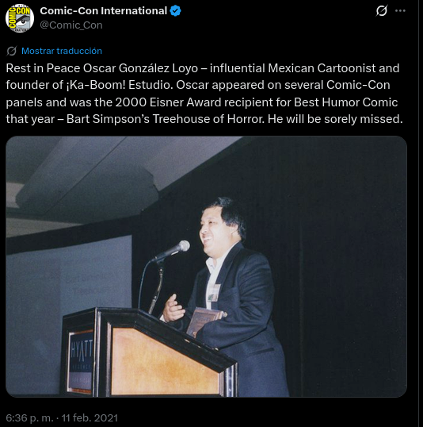

# El Eisner de Oscar

En el año de 1999 Bongo Comics publicaba “Treehouse of Horror #5” o “La casita del Horror No. 5” que contaba con la participación de Jill Thompson, Sergio Aragonés, Scott Shaw, entre otros. Y entre esos otros se encontraba nuestro Monero Favorito. Oscar Gonzalez Loyo.

La historia que Oscar dibujó fue escrita por Jill Thompson y se llama “Dark Lisa”, una pequeña historia sobre Lisa adquiriendo poderes telequinéticos tras ingerir pescado en la cafetería escolar. Contiene uno de los mejores páneles que haya visto en cualquier historieta de los Simpsons, mostrando a Lisa como una especie de Dark Phoenix. Tengo que admitir que es una historia muy buena, y bastante bien dibujada.

En algún momento (que no sé cuando vaya a llegar) podría hacer una reseña del comic completo.

A resumidas cuentas, en el año 2000 este comic se llevó el Premio Eisner por mejor publicación de humor. Esto es un hecho innegable. Se puede comentar o no si el premio fue de rebote, aunque en mi honesta impresión, el arte tiene un momento muy destacable en el ya mencionado panel. Si bien es cierto que la misma Bongo Comics no reconoce en la portada a OGL.

Las historias sobre como es que recibió su premio varían dependiendo a la persona que le pregunten. Lo que es una realidad es que Oscar no habría vuelto a ser si quiera mencionado si fuera verdad eso de que robó la placa. Fue homenajeado por la misma página de la comic-con, aunque la redacción pareciera haber sido hecha por un becario.

Lo que sí es verdad, es que aparentemente Oscar y Horacio no salieron de la mejor forma de Bongo Comics. Pero eso lo hablaré en otro momento.
